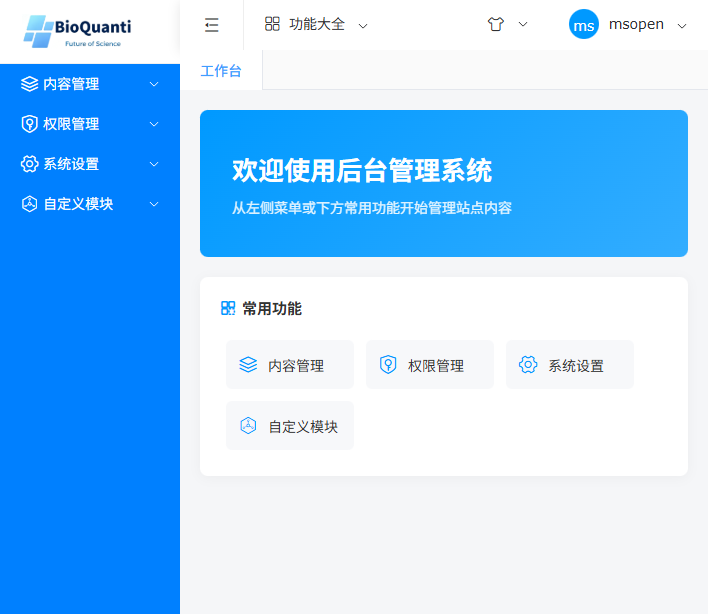
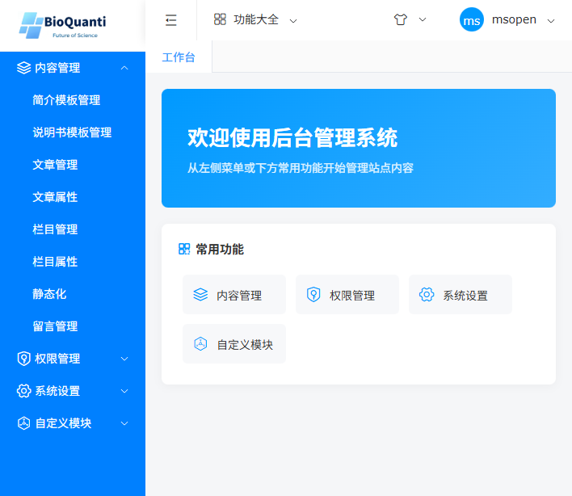
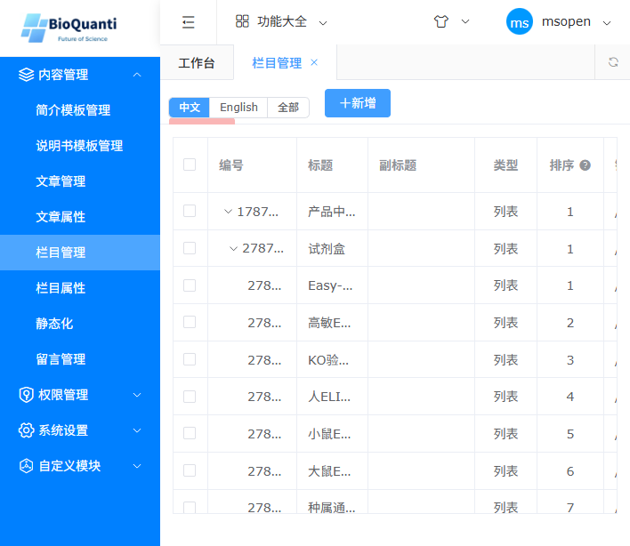
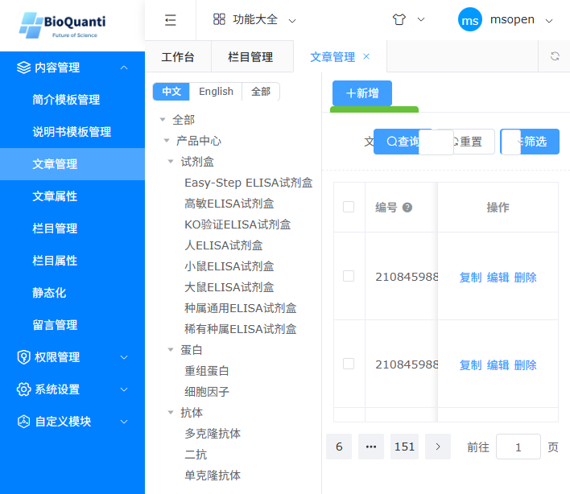
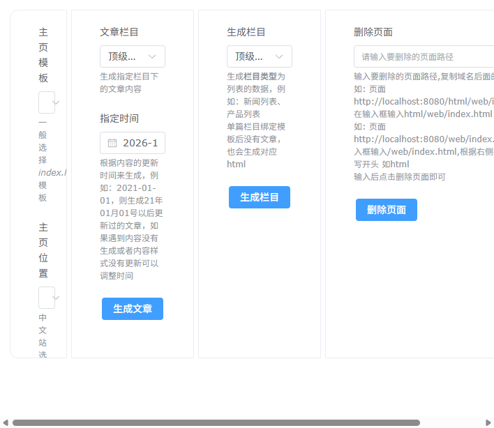
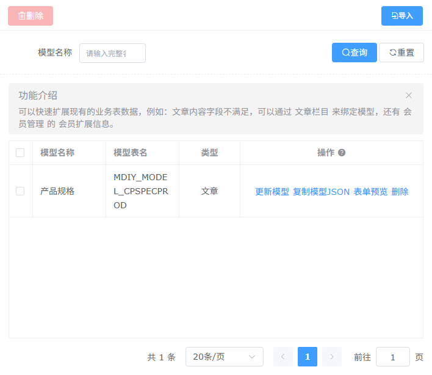

# BioQuanti CMS 系统使用操作手册

> 适用对象：网站内容运营人员
> 系统版本：MCMS 6.2.1（铭飞 CMS 二次开发版）— BioQuanti 定制
> 后台地址：https://zh.bioquanti.com/ms/login.do
> 文档整理：2026-10-11（截图均来自生产环境后台）
>
> 本手册只覆盖 **内容管理** 与 **自定义模块 → 自定义模型** 两大板块，与 BioQuanti 产品站的日常运营直接相关。权限管理、系统设置等板块由管理员维护，不在本手册范围内。

---

## 1. 系统简介

BioQuanti CMS 是基于铭飞 MCMS 6.2.1（Spring Boot + MySQL + FreeMarker）二次开发的企业官网内容管理系统，采用 **"后台维护数据 → 生成静态页面 → Nginx 对外发布"** 的工作模式：

```
后台（管理数据）            静态页（生成 HTML）           前台（访客看到）
┌────────────────┐   静态化   ┌──────────────────┐   发布   ┌─────────────────┐
│ 文章/栏目/产品规格 │ ───────→ │ /opt/mcms/html/web │ ─────→ │ zh.bioquanti.com │ 中文站
│ 说明书模板/模型   │          │   ├─ cn/ 中文      │          │ bioquanti.com   │ 英文站
└────────────────┘          │   └─ en/ 英文      │          └─────────────────┘
                            └──────────────────┘
```

- **中英双语**：中文站 `zh.bioquanti.com`，英文站 `bioquanti.com`，后台通过顶部"中文 / English"标签切换维护不同语言的内容。
- **静态化机制**：后台修改文章后，前台**不会立即更新**，必须执行"静态化"把数据渲染成 HTML 文件；这也是本系统最重要的一个操作习惯。
- **产品数据**：每篇产品文章除了标题、正文，还挂着一组"产品规格"扩展字段（货号、规格、价格等，由自定义模型提供），产品详情页和说明书 PDF 都依赖这些字段。

---

## 2. 登录后台

1. 浏览器打开后台地址：`https://zh.bioquanti.com/ms/login.do`
2. 输入账号、密码；验证码如无法看清可点击"换一张"
3. 点击【登录】进入工作台


> 账号由管理员分配。忘记密码请联系管理员在「权限管理 → 管理员管理」中重置。

---

## 3. 后台界面总览

登录后进入工作台。左侧为功能菜单，顶部是多标签页（同浏览器标签类似，可同时打开多个管理页）。



与本手册相关的菜单结构：

```
内容管理
├─ 简介模板管理        （公司简介等固定栏目的编辑模板）
├─ 说明书模板管理      （产品说明书 HTML 模板，批量生成 PDF 附件）
├─ 文章管理            ★ 核心：所有栏目下的文章/产品数据
├─ 文章属性
├─ 栏目管理            ★ 网站栏目树维护
├─ 栏目属性
├─ 静态化              ★ 生成/删除静态页面（前台更新入口）
└─ 留言管理            （联系表单提交记录）

自定义模块
├─ 自定义页面
├─ 自定义模型          ★ 产品规格等扩展字段定义
├─ 自定义业务
├─ 自定义配置
└─ 自定义字典
```



---

## 4. 内容管理

### 4.1 栏目管理

栏目即网站的目录结构。产品中心、新闻、关于我们等都是栏目，产品栏目之间有层级（父栏目/子栏目）。

**进入方式**：内容管理 → 栏目管理



页面说明：

| 区域 | 说明 |
|---|---|
| 中文 / English / 全部 | 按语言过滤栏目树。中文栏目和英文栏目是两套独立数据，路径分别以 `cn/`、`en/` 开头 |
| 栏目列表 | 树形展示：编号、标题、类型（列表/单页）、排序等 |
| ＋新增 | 新建栏目（填写标题、上级栏目、栏目路径、绑定模板等） |

日常运营注意：

1. **不要随意修改产品栏目的"栏目路径"**——路径变更会导致已生成的静态页地址变化，需清理旧页面并重新静态化。
2. 新增栏目后需要**重新静态化**该栏目及其上级栏目，前台才会出现新栏目页。
3. 栏目排序影响前台导航和列表的显示顺序，修改后同样需静态化生效。
4. 严禁删除还在使用的栏目（会连带影响栏目下的所有文章）。

### 4.2 文章管理

所有产品、新闻、技术资料都是"文章"。产品文章除常规内容外还挂有产品规格扩展字段（见第 5 章）。

**进入方式**：内容管理 → 文章管理



页面说明：

| 区域 | 说明 |
|---|---|
| 中文 / English / 全部 | 切换维护不同语言的文章（与栏目语言对应） |
| 左侧栏目树 | 按栏目过滤文章；点击栏目名称只显示该栏目下文章 |
| ＋新增 | 在当前选中栏目下新建文章 |
| 查询 / 重置 / 筛选 | 按标题等条件搜索 |
| 操作列：复制 / 编辑 / 删除 | 复制=以该文章为模板新建；编辑=修改；删除=移入回收 |
| 分页 | 产品文章较多（中英各 1400+ 篇），可用底部页码跳转 |

**编辑文章**：点击列表中的【编辑】进入编辑页。编辑页自上而下主要区域：

1. **基本设置**：文章标题、副标题、所属栏目、作者、发布时间、是否显示、缩略图（产品缩略图；无图时前台自动显示默认图，多图时前台仅取第一张展示）、摘要、关键词、描述（SEO 用）；
2. **文章内容**：富文本编辑器，填写正文（详情介绍、检测范围说明等）；
3. **自定义模型字段（产品规格）**：编辑页下方的"产品规格"区域，逐项填写该产品的货号、中英文名称、规格、灵敏度、检测范围、价格等数据（字段清单见 5.2）；
4. **保存**：编辑完成后点击保存。**注意：保存后前台不会立即变化，需到「静态化」执行"生成文章"。**

运营注意：

1. **货号（CATALOG_NO）是产品的唯一标识**，必填且不要重复、不要随意修改（说明书 PDF 文件名、数据关联都依赖货号）。
2. 产品价格字段只填纯数字（如 `1980`），人民币符号、英文站"询价"等展示效果由前台模板自动处理，**不要把单位写进价格字段**。
3. 删除产品请谨慎：删除文章后需重新静态化对应栏目，并且该产品已生成的说明书 PDF 文件仍会留在服务器（需磁盘治理清理）。
4. 中文站找不到某产品时，先确认顶部是否选对了语言标签（中文/English）。

### 4.3 静态化

静态化是"把后台数据渲染成前台 HTML 文件"的动作。**后台所有数据修改，都要通过静态化才能在前台生效。**

**进入方式**：内容管理 → 静态化



页面从左到右分几块：

| 区块 | 功能 | 使用场景 |
|---|---|---|
| 主页模板 / 主页位置 | 选择站点（中文站/英文站），生成首页 | 首页内容（如产品列表、简介）变化后 |
| 生成文章 | 选择文章栏目 + 指定时间，重新生成该栏目下更新时间晚于指定时间的文章详情页 | **最常用**：修改产品资料/价格后，选对应栏目、时间选早一点（如 2021-01-01）即可全部重生成 |
| 生成栏目 | 生成栏目类型的列表页（栏目首页、产品列表页） | 栏目下文章增删、栏目设置变化后 |
| 删除页面 | 输入页面路径，删除指定静态页 | 文章被删除/栏目调整后清理残留页面 |

标准操作顺序（数据修改后）：

```
1. 生成文章（对应栏目，指定时间选早一些）   → 产品详情页生效
2. 生成栏目（对应栏目）                    → 产品列表页生效
3. 生成首页（主页模板/主页位置）            → 首页生效
```

> 如果修改后前台仍显示旧内容，先强制刷新浏览器（Ctrl+F5）；仍不行则确认静态化时选对了"站点"和"栏目"。公司使用 CDN 加速，大范围更新后可联系管理员刷新 CDN 缓存。

### 4.4 说明书模板管理

说明书模板是产品详情页"说明书下载" PDF 的模板来源（HTML 模板 + 产品规格字段自动渲染）。

**进入方式**：内容管理 → 说明书模板管理

功能一览：

| 功能 | 说明 |
|---|---|
| 新建/替换模板 | 上传模板 HTML 文件；替换后所有绑定产品"下次生成"即用新模板，无需重新绑定 |
| 绑定产品 | 选择栏目/搜索货号，勾选产品批量绑定到该模板（一个产品只能绑一个模板） |
| **生成附件** | 对该模板绑定的全部产品批量生成说明书 PDF，并自动静态化对应产品页（前台立即出现下载按钮）。生成过程弹窗中有**双进度条**：蓝色进度条逐个显示附件生成进度（每个附件生成完成走一格），橙色进度条显示静态化进度（每静态化一个页面走一格），并实时显示当前处理的货号、成功/失败计数 |
| 预览 / 下载 | 预览模板渲染效果；下载模板 HTML 源文件 |
| 编辑 | 在线编辑模板 HTML（占位符 `{{字段名}}` 写法，可用字段点"可用字段清单"查看） |
| 磁盘治理 | 扫描/清理服务器上的孤儿 PDF 文件 |

使用建议：批量生成附件耗时较长，点"生成附件"后保持弹窗打开等待进度条走完即可，不必反复点击；完成后弹窗会提示成功/失败数量。

### 4.5 简介模板管理

公司简介、技术支持等"单页"栏目的编辑模板，操作方式与文章编辑类似，按需修改后同样需要静态化对应栏目生效。

---

## 5. 自定义模块 → 自定义模型

### 5.1 概念

"自定义模型"用于给文章等业务数据**扩展字段**。模型定义了一组字段，绑定到栏目后，该栏目下的文章编辑页就会出现这些字段的输入区，数据存入独立的数据表。

本站目前只有一个核心模型：**产品规格**（表名 `MDIY_MODEL_CPSPECPROD`，类型"文章"），产品详情页展示、产品列表价格、说明书 PDF 全部依赖该模型数据。

**进入方式**：自定义模块 → 自定义模型



### 5.2 产品规格模型字段清单

| 字段（中文） | 数据库列 | 类型 | 说明 |
|---|---|---|---|
| 货号 | CATALOG_NO | VARCHAR | **必填、唯一**，产品唯一标识 |
| 产品中文名称 | PRODUCT_CN | VARCHAR | 中文站显示用 |
| 产品英文名称 | PRODUCT_EN | VARCHAR | 英文站显示用 |
| 规格 | SPEC | VARCHAR | 如 96T、48T |
| 灵敏度 | SENSITIVITY | VARCHAR | |
| 检测范围 | DETECT_RANGE | VARCHAR | |
| 标准品浓度 | STD_TOP | VARCHAR | |
| 样本名称 | SAMPLE_NAME | VARCHAR | |
| 标准稀释系列 | STD_DILUTION_SERIES | VARCHAR | |
| 交叉反应浓度 | CROSS_REACT_CONC | VARCHAR | |
| 背景 | BACKGROUND | TEXT | 长文本 |
| 标准曲线表 | CAL_TABLE | TEXT | 长文本 |
| 样本表 | SAMPLE_TABLE | TEXT | 长文本 |
| 精密度表 | PRECISION_TABLE | TEXT | 长文本 |
| 回收率表 | RECOVERY_TABLE | TEXT | 长文本 |
| 线性表 | LINEARITY_TABLE | TEXT | 长文本 |
| 文献 | LITERATURE | TEXT | 长文本 |
| 说明书 | MANUAL | TEXT | 生成附件后回填 PDF 路径，**请勿手工修改** |
| 规格价格 | SPEC_PRICE | TEXT | JSON 数组格式（见下），**格式错误会导致编辑页打不开** |

> 具体字段以后台编辑页和说明书模板管理的"可用字段清单"为准。模型字段如需增删，由管理员操作（见 5.3）。

`SPEC_PRICE`（规格价格）的正确格式为 JSON 数组，每行一个规格+价格：

```json
[{"spec":"96T","price":"1980"},{"spec":"48T","price":"1280"}]
```

### 5.3 模型操作说明

列表中每个模型有四个操作：

| 操作 | 作用 | 风险等级 |
|---|---|---|
| 更新模型 | 通过导入模型 JSON 配置来修改模型（字段增删改）；**会同步修改数据表结构（先删后建字段）** | ★★★ 高危 |
| 复制模型JSON | 导出当前模型的 JSON 配置（修改前的备份手段） | 安全 |
| 表单预览 | 预览模型字段渲染出来的表单效果 | 安全 |
| 删除 | 删除模型 | ★★★ 高危 |

**日常运营不需要操作自定义模型**。字段调整属于结构性变更：

1. 更新模型会**删除并重建字段列**，操作前务必用"复制模型JSON"备份现有配置；
2. 只允许**新增字段**，不要修改已有字段的列名/类型（会导致该列已有数据丢失）；
3. 更新模型后必须"重新静态化"相关页面，新字段才会出现在前台和说明书模板的可用字段清单里。

---

## 6. 常见问题（FAQ）

**Q1：后台改完了，前台怎么没变化？**
后台保存只写数据库，前台读的是静态 HTML。到「内容管理 → 静态化」按 4.3 的顺序执行生成；浏览器再 Ctrl+F5 强刷。

**Q2：产品列表/详情页价格显示"询价"或不显示价格？**
检查该文章"产品规格"里的 SPEC_PRICE 是否为空、格式是否为标准 JSON 数组、价格是否为纯数字。改完需重新静态化。

**Q3：产品编辑页打不开或前端报错？**
多为 SPEC_PRICE / CAL_TABLE 等字段格式被破坏（如填了纯文本导致前端解析失败）。联系管理员核对字段格式，必要时从备份恢复该字段数据。

**Q4：说明书下载按钮不出现？**
确认产品已绑定说明书模板（说明书模板管理 → 绑定产品），且对该模板执行过"生成附件"。解绑后需重新静态化产品页才会移除按钮。

**Q5：文章删除后前台还能访问？**
静态页不会自动删除。到「静态化 → 删除页面」输入该文章页面路径删除，并重新生成对应栏目列表页。

**Q6：生成附件/静态化很慢正常吗？**
正常。批量生成附件是逐个渲染 PDF 并逐页静态化（1470+ 产品约需数分钟），进度条走完前请勿关闭弹窗或重复点击。
